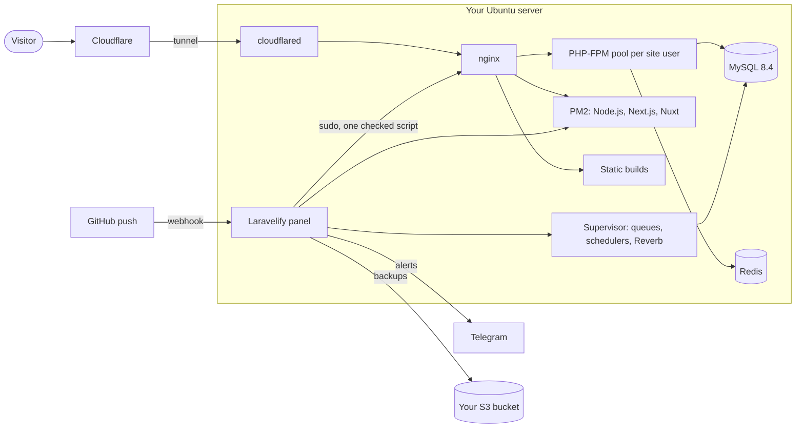

<p align="center">
  <picture>
    <source media="(prefers-color-scheme: dark)" srcset="brand/laravelify-brand-assets/04-social/png/laravelify-readme-banner-dark-1600.png">
    
  </picture>
</p>

<p align="center">
  <a href="https://github.com/laravelify-cloud/laravelify/actions/workflows/tests.yml"></a>
  <a href="https://github.com/laravelify-cloud/laravelify/releases/latest"></a>
  <a href="LICENSE"></a>
  
  
  <a href="https://github.com/laravelify-cloud/laravelify/stargazers"></a>
</p>

<p align="center">
  <a href="https://laravelify.cloud"><b>Website</b></a> ·
  <a href="https://laravelify.cloud/#install"><b>Install command builder</b></a> ·
  <a href="https://docs.laravelify.cloud"><b>Documentation</b></a> ·
  <a href="https://docs.laravelify.cloud/quickstart">Quickstart</a> ·
  <a href="CHANGELOG.md">Changelog</a> ·
  <a href="https://github.com/laravelify-cloud/laravelify/issues">Issues</a>
</p>

---

> [!NOTE]
> Laravelify is in **public beta**. It runs real production sites, but things can still change between versions. Try it on a fresh server first, keep backups (it can make them for you), and [report what breaks](https://github.com/laravelify-cloud/laravelify/issues).

**Laravelify** is an open-source, self-hosted control panel that turns one Ubuntu server into a home for all your apps:

- **Backends:** Laravel and plain PHP (8.0 to 8.5), Express, NestJS, and any Node.js server
- **Front ends:** React, Vue.js, Angular, Svelte, Astro, and static HTML
- **Full-stack:** Next.js, Nuxt, SvelteKit, Laravel + Livewire, Laravel + Inertia

Push to GitHub and your site deploys. Open the panel and you see live traffic, errors, attacks, and server load, browse and edit your databases, read logs, and run commands. Your server, your data, no monthly bill, no per-seat pricing.

Inspired by [Coolify](https://coolify.io), built with Laravel 13, Livewire 4, Alpine, and Tailwind 4, and **without Docker**: PHP runs on nginx + PHP-FPM (Laravel with Supervisor workers), Node.js servers run under PM2, and front-end builds are served as files by nginx. Fewer moving parts, less memory, and nothing between your app and the server.

## Contents

- [Install](#install)
- [What's inside](#whats-inside)
- [How it works](#how-it-works)
- [Supported apps](#supported-apps)
- [Requirements](#requirements)
- [Update, repair, uninstall](#update-repair-uninstall)
- [Security model](#security-model)
- [Use it from an AI assistant (MCP)](#use-it-from-an-ai-assistant-mcp)
- [Development](#development)
- [Repositories](#repositories)
- [Support and sponsors](#support-and-sponsors)

## Install

On a fresh **Ubuntu 22.04, 24.04, or 26.04** server, as a user that can use `sudo`:

```bash
curl -fsSL https://cdn.laravelify.cloud/install.sh | sudo bash
```

You always get the **latest release**. The installer asks for four things:

| Prompt | Example | Used for |
| --- | --- | --- |
| MySQL root password (twice) | a long random password | MySQL root, phpMyAdmin sign-in, site databases |
| Panel domain | `panel.example.com` | The panel's address |
| phpMyAdmin domain | `db.example.com` | phpMyAdmin's address |
| Cloudflare tunnel token | `eyJh…` | Connects the server to Cloudflare (HTTPS, no open ports) |

Then it works through the install one step at a time, with a spinner, a check mark, and the time of every step:

```text
┌  Laravelify installer · self-hosted deployment panel
│
◇  Settings
│  Server               Ubuntu 24.04.3 LTS
│  PHP-FPM              8.3 8.4
│  Node.js              22 24 (system: 24)
│  Log                  /var/log/laravelify-install.log
│
◆  Downloaded Laravelify 0.3.0-beta.51 4s
◆  Installing nginx, Redis, Supervisor, Git, and tools 38s
◆  Installing PHP 8.3 (FPM, CLI, MySQL, Redis, GD, intl, and more) 51s
◆  Installing PHP 8.4 (FPM, CLI, MySQL, Redis, GD, intl, and more) 47s
◆  Installing MySQL 8.4 1m 12s
◆  Installing phpMyAdmin 22s
◆  Installing Node.js 24, npm, and PM2 31s
   …
◆  Turning on the firewall (SSH, 80, 443) 2s
│
└  Laravelify 0.3.0-beta.51 is installed (7m 40s)
```

It ends with your setup link (`https://panel.example.com/setup?token=…`): open it to create the admin account with two-factor sign-in. Only that link opens the setup page, so nobody who finds a fresh panel first can claim it.

### Choose what to install

By default you get PHP-FPM 8.0 to 8.5 and Node.js 20, 22, and 24. Install only what your sites use with the **[install command builder](https://laravelify.cloud/#install)**, or pass the options yourself:

```bash
curl -fsSL https://cdn.laravelify.cloud/install.sh | sudo bash -s -- --php=8.3,8.4 --node=22,24 --panel-domain=panel.example.com
```

| Option | Description |
| --- | --- |
| `--php=8.3,8.4` | PHP-FPM versions (8.0 to 8.5). The panel needs 8.4 or newer; 8.4 is added if neither 8.4 nor 8.5 is chosen. |
| `--node=22,24` | Node.js majors (20, 22, 24). The newest is the system Node.js. |
| `--panel-domain=HOST` | The panel's domain (otherwise asked) |
| `--phpmyadmin-domain=HOST` | phpMyAdmin's domain (otherwise asked) |
| `--help` | All options |

The MySQL password and the tunnel token are always asked on the server, so they never end up in a copied command. For unattended installs every prompt is also an environment variable: see the [installation guide](https://docs.laravelify.cloud/installation/install).

### What gets installed

| Area | Packages |
| --- | --- |
| Web and PHP | nginx, PHP-FPM with the extensions Laravel needs (MySQL, Redis, GD with JPEG/PNG/WebP, intl, bcmath, zip, mbstring, curl, xml), Composer |
| Data | MySQL 8.4 LTS, Redis, phpMyAdmin (one-click sign-in from the panel) |
| Node and processes | Node.js through `n`, PM2, Supervisor |
| Network and security | cloudflared, ufw (only SSH, 80, and 443 open), the panel's own user, a user per website, a sudo rule limited to one checked script |

The panel lives in `/opt/laravelify`, websites in `/var/www/<slug>`, and the install log in `/var/log/laravelify-install.log`.

## What's inside

### 🚀 Deploys

- **Git push to deploy** through a **GitHub App** (created in one click, private repositories, automatic webhooks) or a personal token, with a branch per site.
- **Live build log** in a real console that streams while the build runs: commands, warnings, and errors in colour, no jumping.
- **Deployments page**: every website as a card with its latest deploy (waiting, in progress, finished, failed), commit, trigger, and time, with Deploy and Watch live.
- npm, pnpm, and Yarn are detected from the lock file; Composer, migrations, and caches for Laravel; zero-config builds for the front-end frameworks.
- **Example projects** for every framework to try a deploy in a minute.
- **One-click MySQL database** per site, `.env` editor with secrets hidden, nginx editor with a config test and automatic rollback, Supervisor and PM2 process editors.

### 🗄️ Database tool

- Browse every database and table in a fast **grid** (AG Grid Community): scroll through millions of rows (loaded from the server as you scroll), spreadsheet-style **header filters** with value counts, sort, pin, resize, and hide columns.
- **Search** in every database at once, by table name, column name, or the data itself.
- **Edit rows** in a form made for each column type (date and time pickers, enum lists, NULL), add and delete rows. Every change goes to a **change log you can undo**.
- **Foreign keys** both ways: click a value to open the row it points at, or the rows that point at it.
- **SQL console** with Ctrl+Enter, structure view, export to SQL, triggers, procedures, functions, and events.
- **Encrypted columns**: add your site's own encryption method (PHP code that runs inside your site, with its own keys), mark a column, and it is shown, searched, filtered, and edited decrypted. Only the setting is saved; the data never leaves your site decrypted.

### 💾 Backups to S3

- Databases and folders to **your own S3 bucket** (AWS, DigitalOcean Spaces, Cloudflare R2, MinIO…), on a schedule or as one **Full backup** with a tick box per database.
- Automatic excludes per app type (`vendor`, `node_modules`, build output).
- **Look inside a backup** (tables, procedures, functions, triggers, events), download parts as SQL, and **restore** a whole database, some tables, or some folders.

### 📈 Monitoring and alerts

- **Requests and response times** (p50, p95), status codes, top routes, countries, and a live request feed for every site.
- **Uptime checks**, **issues** (Laravel errors grouped by exception and line, with stack traces), **heartbeats** for cron jobs.
- **Attack detection**: SQL injection, XSS, path traversal, scanners, and attack tools, with one-click IP blocking.
- **Server monitoring**: live CPU, memory, load, disk, network, services, and the busiest processes.
- **Telegram alerts** for deploys, downtime, crashed workers, error spikes, slow responses, attacks, a full disk, and pending security patches.

### 🧰 Tools

- **Terminal** in a real console (xterm.js) for every site and the whole server: answer a question a command asks (`Proceed? (Y/n)`), Ctrl+C, colours, and `/` autocomplete for Artisan, npm, PM2, and Supervisor commands.
- **File manager** with an editor, upload and download, bulk copy and move, zip and unzip in the background, and a **trash with versions**.
- **Logs** (Laravel, workers, PM2, nginx), **health checks**, ports, processes, and server services (MySQL, Redis, PHP-FPM, phpMyAdmin settings).
- **Turn sites on and off**: pause a website or a whole group with a "turned off" page, stopped workers, and paused deploys and alerts.
- Everything is stored in UTC and shown in each viewer's own timezone and date format.

## How it works



- **No Docker.** Each site is a folder (`/var/www/<slug>`), an nginx server block, and, depending on its type, a PHP-FPM pool, PM2 app, or Supervisor programs that the panel writes and keeps in step.
- **Deploys** run in the panel's queue worker: pull, install, build, migrate, cache, reload, with every line in the live log and a Telegram message at the end.
- **Cloudflare tunnels** give every site HTTPS without opening ports; one tunnel serves many sites, and the panel adds the DNS records when you give it an API token.
- **The panel only reaches the system through `scripts/host-apply.sh`**, a single script that checks every argument and file before it writes nginx, Supervisor, PM2, or PHP-FPM settings.

## Supported apps

| Type | How it runs | Versions |
| --- | --- | --- |
| Laravel | nginx + PHP-FPM, Supervisor queue and scheduler workers, optional Reverb | PHP 8.0–8.5 |
| PHP | nginx + PHP-FPM | PHP 8.0–8.5 |
| Express, NestJS, Node.js | PM2 behind nginx | Node 20, 22, 24 |
| Next.js, Nuxt, SvelteKit | PM2 (Next.js standalone supported) behind nginx | Node 20, 22, 24 |
| React, Vue.js, Angular, Svelte, Astro | Built on the server, served as files by nginx | Node 20, 22, 24 |
| Static HTML | Served as files by nginx | — |

## Requirements

| | Minimum | Recommended |
| --- | --- | --- |
| Ubuntu | 22.04 LTS | 24.04 LTS (26.04 works, PHP from the Sury repository) |
| CPU | 2 vCPU | 4 vCPU |
| Memory | 2 GB | 4 GB or more (Next.js and Nuxt builds need memory) |
| Disk | 30 GB SSD | 60 GB SSD or more |
| Network | A domain on Cloudflare and a tunnel token | |

## Update, repair, uninstall

```bash
# Update to the latest release (keeps your settings, sites, and data)
sudo bash /opt/laravelify/scripts/update.sh

# Running the install command again also offers an update;
# repair the whole install (re-checks every package) with:
curl -fsSL https://cdn.laravelify.cloud/install.sh | sudo LARAVELIFY_REINSTALL=1 bash
```

Updates download the newest release, run the migrations, restart the panel's workers without killing a deploy in progress, and add anything newer installs have (like PHP GD). See [Updating](https://docs.laravelify.cloud/installation/updating) and [Uninstall](https://docs.laravelify.cloud/installation/uninstall).

## Security model

- **One admin, two-factor sign-in required**, and secrets (tokens, passwords, `.env` values) are only shown after a fresh authenticator code.
- **Separate users**: the panel runs as `laravelify` with its own PHP-FPM pool; every website runs as its own user (`lfy-<slug>`), so a site cannot read the panel or another site.
- **Sandboxed terminal**: commands run as the site's user, with the rest of the system read-only, a private `/tmp`, and a time limit.
- **Least privilege for root**: the panel may only run `scripts/host-apply.sh` as root, and that script validates everything it is given.
- **Firewall** with only SSH, 80, and 443 open, and HTTPS through Cloudflare.
- **An extra sign-in prompt** in front of the panel and phpMyAdmin (Security → Access), with an allowlist of IPs that skip it.

Report vulnerabilities privately as described in [SECURITY.md](SECURITY.md).

## Use it from an AI assistant (MCP)

Laravelify has a built-in [MCP](https://modelcontextprotocol.io) server. Create a token in **Settings → MCP**, connect Claude Code, Claude Desktop, Cursor, or any MCP client, and say things like:

> Deploy acme/shop on shop.example.com with a MySQL database, then show me the log.

The assistant can create and deploy websites, read deploy logs and site logs, set environment variables, change domains and redirects, run a command in a site folder, upload files, import a database dump, and run backups. It is told to ask you before deleting anything.

## Development

```bash
git clone https://github.com/laravelify-cloud/laravelify.git && cd laravelify
composer install && cp .env.example .env && php artisan key:generate
php artisan migrate
npm install && npm run dev
php artisan serve
```

On Windows and macOS (or with `LARAVELIFY_HOST_COMMANDS=false`) system commands are not run: every nginx, Supervisor, and PM2 file is written to `storage/app/rendered` so you can see what would be applied.

```bash
php artisan test --compact     # PHPUnit
vendor/bin/pint                # code style
```

| Path | What |
| --- | --- |
| `app/Livewire` | The pages (one component per page or tab) |
| `app/Services` | Deployer, backups, monitoring, database tool, host commands |
| `app/Mcp` | The MCP server and its tools |
| `scripts/install.sh`, `scripts/update.sh` | Installer and updater |
| `scripts/host-apply.sh` | The only script the panel runs as root |
| `resources/views`, `resources/js`, `resources/css` | Blade, Alpine, AG Grid, xterm.js, Tailwind |
| `tests/` | Feature and unit tests |

Read [CONTRIBUTING.md](CONTRIBUTING.md) before opening a pull request. Releases are tagged `vX.Y.Z`; the **Release** workflow builds the assets and attaches `laravelify.tar.gz` and `install.sh` to the GitHub release, and `cdn.laravelify.cloud/install.sh` always runs the newest one.

## Repositories

| Repository | What it is |
| --- | --- |
| [**laravelify**](https://github.com/laravelify-cloud/laravelify) | The panel, the installer, and the releases (this repository) |
| [**laravelify-docs**](https://github.com/laravelify-cloud/laravelify-docs) | The documentation at [docs.laravelify.cloud](https://docs.laravelify.cloud) |
| [**laravelify-website**](https://github.com/laravelify-cloud/laravelify-website) | The website and install command builder at [laravelify.cloud](https://laravelify.cloud) |
| [**.github**](https://github.com/laravelify-cloud/.github) | The organization profile and shared community files |

## Support and sponsors

Laravelify is free and has no paid plan. If it saves you time:

- ⭐ [Star the repository](https://github.com/laravelify-cloud/laravelify) so more people find it
- 🐞 Report bugs and ideas in [Issues](https://github.com/laravelify-cloud/laravelify/issues)
- ☕ [Buy me a coffee](https://buymeacoffee.com/arshadarsh01)
- 💜 [Sponsor Laravelify](https://github.com/sponsors/laravelify-cloud), or see the [sponsor tiers](https://laravelify.cloud/#sponsors)

## Maintainer

Built and maintained by **[Arshad Arshadli](https://github.com/ArshadArshadli01)** in Azerbaijan 🇦🇿. Say hi on [X](https://x.com/a_arshadli) or [LinkedIn](https://linkedin.com/in/arshad-arshadli-170991201).

## License

Laravelify is open-source software licensed under the [MIT license](LICENSE). Brand assets are in [`brand/`](brand).
