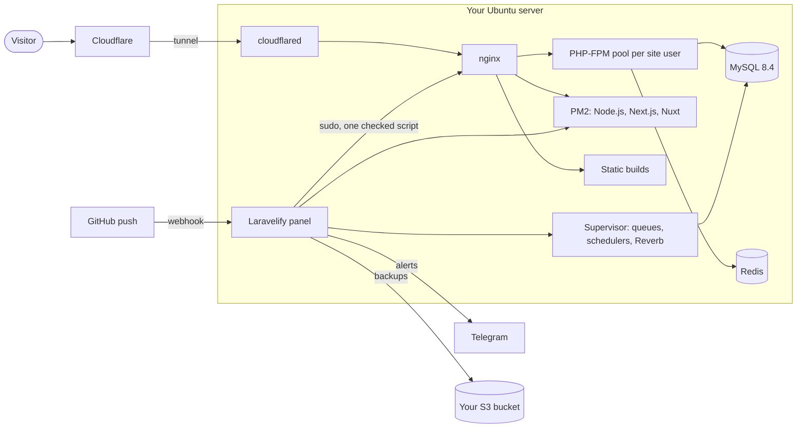

<p align="center">
  <picture>
    <source media="(prefers-color-scheme: dark)" srcset="brand/laravelify-brand-assets/04-social/png/laravelify-readme-banner-dark-1600.png">
    
  </picture>
</p>

<p align="center">
  <a href="https://github.com/laravelify-cloud/laravelify/actions/workflows/tests.yml"></a>
  <a href="https://github.com/laravelify-cloud/laravelify/releases/latest"></a>
  <a href="LICENSE"></a>
  
  
  <a href="https://github.com/laravelify-cloud/laravelify/stargazers"></a>
</p>

<p align="center">
  <a href="https://laravelify.cloud"><b>Website</b></a> ·
  <a href="https://laravelify.cloud/#install"><b>Install command builder</b></a> ·
  <a href="https://docs.laravelify.cloud"><b>Documentation</b></a> ·
  <a href="https://docs.laravelify.cloud/quickstart">Quickstart</a> ·
  <a href="CHANGELOG.md">Changelog</a> ·
  <a href="https://github.com/laravelify-cloud/laravelify/issues">Issues</a>
</p>

---

> [!NOTE]
> Laravelify is in **public beta**. It runs real production sites, but things can still change between versions. Try it on a fresh server first, keep backups (it can make them for you), and [report what breaks](https://github.com/laravelify-cloud/laravelify/issues).

**Laravelify** is an open-source, self-hosted control panel that turns one Ubuntu server into a home for all your apps:

- **PHP:** Laravel and plain PHP (7.4 to 8.5)
- **Java and C#:** Spring Boot and ASP.NET Core
- **Python:** Django, Flask, and FastAPI
- **Go and JavaScript servers:** Go, Bun, Express, NestJS, and any Node.js server
- **Front ends:** React, Vue.js, Angular, Svelte, Astro, Hugo, Gatsby, Docusaurus, VitePress, Eleventy, and static HTML
- **Full-stack:** Next.js, Nuxt, SvelteKit, Laravel + Livewire, Laravel + Inertia

Push to GitHub and your site deploys. Open the panel and you see live traffic, errors, attacks, and server load, browse and edit your databases, read logs, and run commands. Your server, your data, no monthly bill, no per-seat pricing.

Inspired by [Coolify](https://coolify.io), built with Laravel 13, Livewire 4, Alpine, and Tailwind 4, and **without Docker**: PHP runs on nginx + PHP-FPM (Laravel with Supervisor workers), Node.js servers run under PM2, and front-end builds are served as files by nginx. Fewer moving parts, less memory, and nothing between your app and the server.

## Contents

- [Install](#install)
- [What's inside](#whats-inside)
- [How it works](#how-it-works)
- [Supported apps](#supported-apps)
- [Requirements](#requirements)
- [Update, repair, uninstall](#update-repair-uninstall)
- [Security model](#security-model)
- [Use it from an AI assistant (MCP)](#use-it-from-an-ai-assistant-mcp)
- [Laravelify Cloud](#laravelify-cloud)
- [Development](#development)
- [Repositories](#repositories)
- [Support and sponsors](#support-and-sponsors)

## Install

On a fresh **Ubuntu 22.04, 24.04, or 26.04** server, as a user that can use `sudo`:

```bash
curl -fsSL https://cdn.laravelify.cloud/install.sh | sudo bash
```

You always get the **latest release**, and **the installer asks nothing**. It installs everything, makes a random 40-character database password, and opens the panel on a port of your server:

1. Open the **setup link** it prints, like `http://203.0.113.10:8000/setup?token=…`, and create the admin account with two-factor sign-in. Only that link opens the setup page, so nobody who finds a fresh panel first can claim it.
2. Go to **Settings → Panel address** and give the panel a domain. Laravelify makes the Cloudflare record for you (with an API token), or you make an A record yourself. The domain is tested over HTTPS before anything changes, and afterwards the old port only redirects to it.

Until the panel has a domain it is plain HTTP, so do step 2 before you use it for real work. The database password is on **Server → MySQL** after your authenticator code. phpMyAdmin, when you choose it, opens at `/phpmyadmin` of the panel's address.

Prefer to skip the port? Give the installer a free `https://<name>.laravelify.cloud` address (`LARAVELIFY_CLOUD_KEY=lfy_…`, from [app.laravelify.cloud](https://app.laravelify.cloud) → Dashboard → **Install from a terminal**) or your own Cloudflare tunnel (`CLOUDFLARE_TUNNEL_TOKEN=… PANEL_DOMAIN=panel.example.com`).

**On Hostinger:** in Docker Manager, create a project from [`docker-compose.hostinger.yml`](docker-compose.hostinger.yml). It runs the same installer on the server once and stops; its logs show the setup link.

Then it works through the install one step at a time, with a spinner, a check mark, and the time of every step:

```text
┌  Laravelify installer · self-hosted deployment panel
│
◇  Settings
│  Server               Ubuntu 24.04.3 LTS
│  PHP-FPM              8.3 8.4
│  Node.js              22 24 (system: 24)
│  Log                  /var/log/laravelify-install.log
│
◆  Downloaded Laravelify 0.3.0-beta.107 4s
◆  Installing nginx, Redis, Supervisor, Git, and tools 38s
◆  Installing PHP 8.3 (FPM, CLI, MySQL, Redis, GD, intl, and more) 51s
◆  Installing PHP 8.4 (FPM, CLI, MySQL, Redis, GD, intl, and more) 47s
◆  Installing MySQL 8.4 1m 12s
◆  Installing Node.js 24, npm, and PM2 31s
   …
◆  Turning on the firewall (SSH, 80, 443, 8000) 2s
│
└  Laravelify 0.3.0-beta.107 is installed (7m 40s)
```

It ends with your setup link, like `http://203.0.113.10:8000/setup?token=…`.

### Choose what to install

By default you get PHP-FPM 8.4 and Node.js 24, so the install is quick. Any other version (PHP 7.4 to 8.5, Node 18 to 24) is installed by the panel the first time a website needs it. Pick more up front with the **[install command builder](https://laravelify.cloud/#install)**, or pass the options yourself:

```bash
curl -fsSL https://cdn.laravelify.cloud/install.sh | sudo bash -s -- --php=8.3,8.4 --node=22,24 --panel-domain=panel.example.com
```

| Option | Description |
| --- | --- |
| `--php=8.3,8.4` | PHP-FPM versions (8.0 to 8.5). The panel needs 8.4 or newer; 8.4 is added if neither 8.4 nor 8.5 is chosen. |
| `--node=22,24` | Node.js majors (20, 22, 24). The newest is the system Node.js. |
| `--panel-port=PORT` | The panel's port until it has a domain (default 8000) |
| `--panel-domain=HOST` | Start on this domain instead of a port (with a tunnel token, or an A record you make) |
| `--databases=mysql,postgresql` | Database servers: `mysql` or `mariadb`, `postgresql`, `mongodb`, or `none` (default `mysql`) |
| `--tools=phpmyadmin,vscode` | Optional tools: `phpmyadmin`, `vscode`, `glitchtip`, or `none` (default `phpmyadmin,vscode`; phpMyAdmin only with MySQL or MariaDB) |
| `--phpmyadmin-path=PATH` | phpMyAdmin's path on the panel's address (default `/phpmyadmin`) |
| `--help` | All options |

Tokens and keys go in environment variables, never in options: see the [installation guide](https://docs.laravelify.cloud/installation/install).

### What gets installed

| Area | Packages |
| --- | --- |
| Web and PHP | nginx, PHP-FPM with the extensions Laravel needs (MySQL, Redis, GD with JPEG/PNG/WebP, intl, bcmath, zip, mbstring, curl, xml), Composer |
| Data | MySQL 8.4 LTS (or MariaDB, PostgreSQL, MongoDB), Redis, and with `--tools=phpmyadmin` phpMyAdmin at `/phpmyadmin` (one-click sign-in from the panel) |
| Node and processes | Node.js through `n`, PM2, Supervisor |
| Network and security | cloudflared, ufw (only SSH, 80, and 443 open), the panel's own user, a user per website, a sudo rule limited to one checked script |

The panel lives in `/opt/laravelify`, websites in `/var/www/<slug>`, and the install log in `/var/log/laravelify-install.log`.

## What's inside

### 🚀 Deploys

- **Git push to deploy** through a **GitHub App** (created in one click, private repositories, automatic webhooks) or a personal token, with a branch per site.
- **Live build log** in a real console that streams while the build runs: commands, warnings, and errors in colour, no jumping.
- **Plugins**: PostgreSQL, MySQL, MongoDB, Redis, MinIO, and HashiCorp Vault in one click, with Docker on 127.0.0.1: credentials made and kept encrypted (shown again with your 2FA code), linked to a website as `.env` variables, backed up with your databases, and MinIO's and Vault's pages on a domain behind basic auth.
- **Deployments page**: every website as a card with its latest deploy (waiting, in progress, finished, failed), commit, trigger, and time, with Deploy and Watch live.
- **Roll back** to any earlier deploy in one click: its commit goes live again, and the code it replaces is saved as a `.tar.gz` to download or roll forward to.
- npm, pnpm, and Yarn are detected from the lock file; Composer, migrations, and caches for Laravel; zero-config builds for the front-end frameworks.
- **Example projects** for every framework to try a deploy in a minute.
- **One-click MySQL database** per site, `.env` editor with secrets hidden, nginx editor with a config test and automatic rollback, Supervisor and PM2 process editors.

### 🧑‍💻 VS Code, AI agents, and Live Server

- **VS Code for every website**: a full VS Code ([code-server](https://github.com/coder/code-server)) in the browser, running as the website's own user on its own copy of the repository, with extensions, a terminal, Git, and the debugger. Commit and push to deploy. It is installed with the panel and stops by itself after 30 minutes idle.
- **AI Agents chat** with Claude Code, Cursor Agent, and GitHub Copilot CLI: sign in from a dialog, switch agents in the middle of a task (the next one continues from a recap and a [graphify](https://github.com/Graphify-Labs/graphify) project map), effort levels, restore checkpoints, Add to Chat and Quick Edit on selected code, pasted text and images.
- **Live Server**: Go Live runs the dev server (Next.js, Vite, Nuxt, Node, Laravel, plain PHP) and shows it on a random HTTPS address through the Cloudflare tunnel; saving a file refreshes the page, and stopping removes the address and its DNS record.
- **Environments and previews**: production and development (or staging) of one website side by side, each with its own branch, domain or port, folder, processes, `.env`, database, and Redis prefix. A push deploys only the environment of that branch. Previews on a random subdomain.

### 🗄️ Database tool

- **MySQL, PostgreSQL, SQLite, and MongoDB** in one place, each with export and backup to S3.
- Browse every database and table in a fast **grid** (AG Grid Community): scroll through millions of rows (loaded from the server as you scroll), spreadsheet-style **header filters** with value counts, sort, pin, resize, and hide columns.
- **Search** in every database at once, by table name, column name, or the data itself.
- **Edit rows** in a form made for each column type (date and time pickers, enum lists, NULL), add and delete rows. Every change goes to a **change log you can undo**.
- **Foreign keys** both ways: click a value to open the row it points at, or the rows that point at it.
- **SQL editor** with syntax colors and autocomplete of tables and columns, results in the same filterable grid, and a **history per database** that keeps the rows each UPDATE and DELETE changed, before and after. Structure view, export to SQL, triggers, procedures, functions, and events.
- **Import SQL** of any size (up to 20 GB, `.sql` or `.sql.gz`): uploaded in 8 MB pieces, then streamed into MySQL with checks off and one commit, with live progress and time left. A 666 MB dump loads in about 30 seconds.
- **Tick tables** to empty or drop several at once.
- **phpMyAdmin** at `/phpmyadmin` of the panel, opened signed in from the sidebar.
- **Encrypted columns**: add your site's own encryption method (PHP code that runs inside your site, with its own keys), mark a column, and it is shown, searched, filtered, and edited decrypted. Only the setting is saved; the data never leaves your site decrypted.

### 💾 Backups to S3

- Databases and folders to **your own S3 bucket** (AWS, DigitalOcean Spaces, Cloudflare R2, MinIO…), on a schedule or as one **Full backup** with a tick box per database.
- Automatic excludes per app type (`vendor`, `node_modules`, build output).
- **Look inside a backup** (tables, procedures, functions, triggers, events), download parts as SQL, and **restore** a whole database, some tables, or some folders.

### 📈 Monitoring and alerts

- **Requests and response times** (p50, p95), status codes, top routes, countries, and a live request feed for every site.
- **Uptime checks**, **issues** (Laravel errors grouped by exception and line, with stack traces), **heartbeats** for cron jobs.
- **Attack detection**: SQL injection, XSS, path traversal, scanners, and attack tools, with one-click IP blocking.
- **Server monitoring**: live CPU, memory, load, disk, network, services, and the busiest processes.
- **Telegram alerts** for deploys, downtime, crashed workers, error spikes, slow responses, attacks, a full disk, and pending security patches. With your own bot, or through the Laravelify Cloud bot with no setup.
- **GlitchTip error tracking** on the server (open source, nothing leaves it): one click installs it with a live progress bar, every website gets its project and key, and **Install SDK in the code** adds Sentry to the app and deploys.

### 🧰 Tools

- **Terminal** in a real console (xterm.js) for every site and the whole server: answer a question a command asks (`Proceed? (Y/n)`), Ctrl+C, colours, and `/` autocomplete for Artisan, npm, PM2, and Supervisor commands.
- **File manager** with an editor, upload and download, bulk copy and move, zip and unzip in the background, and a **trash with versions**.
- **Logs** (Laravel, workers, PM2, nginx), **health checks**, ports, processes, and server services (MySQL, Redis, PHP-FPM, phpMyAdmin settings).
- **Turn sites on and off**: pause a website or a whole group with a "turned off" page, stopped workers, and paused deploys and alerts.
- Everything is stored in UTC and shown in each viewer's own timezone and date format.

## How it works



- **No Docker needed.** Each site is a folder (`/var/www/<slug>`), an nginx server block, and, depending on its type, a PHP-FPM pool, PM2 app, or Supervisor programs that the panel writes and keeps in step.
- **Deploys** run in the panel's queue worker: pull, install, build, migrate, cache, reload, with every line in the live log and a Telegram message at the end.
- **Cloudflare tunnels** give every site HTTPS without opening ports; one tunnel serves many sites, and the panel adds the DNS records when you give it an API token.
- **The panel only reaches the system through `scripts/host-apply.sh`**, a single script that checks every argument and file before it writes nginx, Supervisor, PM2, or PHP-FPM settings.

## Supported apps

| Type | How it runs | Versions |
| --- | --- | --- |
| Laravel | nginx + PHP-FPM, Supervisor queue and scheduler workers, optional Reverb | PHP 7.4–8.5 |
| PHP | nginx + PHP-FPM | PHP 7.4–8.5 |
| Express, NestJS, Node.js | PM2 behind nginx | Node 18, 20, 22, 24 |
| Next.js, Nuxt, SvelteKit | PM2 (Next.js standalone supported) behind nginx | Node 18, 20, 22, 24 |
| React, Vue.js, Angular, Svelte, Astro | Built on the server, served as files by nginx | Node 18, 20, 22, 24 |
| Spring Boot (Java) | Built on the server, run by PM2 behind nginx | Java 11, 17, 21 or newer |
| ASP.NET Core (C#) | Built on the server, run by PM2 behind nginx | .NET 6 to 10 |
| Django, Flask, FastAPI (Python) | Run by PM2 behind nginx | Python 3.9 to 3.13 |
| Go | Built on the server, run by PM2 behind nginx | Go 1.18 or newer |
| Bun | Run by PM2 behind nginx | Bun 1.x |
| Any language with a Dockerfile | Built and run with Docker on 127.0.0.1, behind nginx | Docker (installed when needed) |
| Hugo, Gatsby, Docusaurus, VitePress, Eleventy | Built on the server, served as files by nginx | |
| Static HTML | Served as files by nginx | — |

Java, .NET, Python, Go, and Bun are not installed up front: the panel downloads the version a website needs on its first deploy.

## Requirements

| | Minimum | Recommended |
| --- | --- | --- |
| Ubuntu | 22.04 LTS | 24.04 LTS (26.04 works, PHP from the Sury repository) |
| CPU | 2 vCPU | 4 vCPU |
| Memory | 2 GB | 4 GB or more (Next.js and Nuxt builds need memory) |
| Disk | 30 GB SSD | 60 GB SSD or more |
| Network | Nothing to start (the panel opens on port 8000); a domain on Cloudflare for HTTPS later | |

**Need a server?** Get a VPS with Ubuntu 24.04 from [Hostinger](https://www.hostinger.com/in?REFERRALCODE=LARAVELIFY). This is a referral link: Laravelify may earn a commission, which helps fund the project.

## Update, repair, uninstall

```bash
# Update to the latest release (keeps your settings, sites, and data)
sudo bash /opt/laravelify/scripts/update.sh

# Running the install command again also offers an update;
# repair the whole install (re-checks every package) with:
curl -fsSL https://cdn.laravelify.cloud/install.sh | sudo LARAVELIFY_REINSTALL=1 bash
```

Updates download the newest release, run the migrations, restart the panel's workers without killing a deploy in progress, and add anything newer installs have (like PHP GD). See [Updating](https://docs.laravelify.cloud/installation/updating) and [Uninstall](https://docs.laravelify.cloud/installation/uninstall).

## Security model

- **One admin, two-factor sign-in required**, and secrets (tokens, passwords, `.env` values) are only shown after a fresh authenticator code.
- **Separate users**: the panel runs as `laravelify` with its own PHP-FPM pool; every website runs as its own user (`lfy-<slug>`), so a site cannot read the panel or another site.
- **Sandboxed terminal**: commands run as the site's user, with the rest of the system read-only, a private `/tmp`, and a time limit.
- **Least privilege for root**: the panel may only run `scripts/host-apply.sh` as root, and that script validates everything it is given.
- **Firewall** with only SSH, 80, and 443 open, and HTTPS through Cloudflare.
- **An extra sign-in prompt** in front of the panel and phpMyAdmin (Security → Access), with an allowlist of IPs that skip it.
- **Per website**: hide from search engines, refuse crawlers, block IPs, and **basic auth** with a username and password, or with your 6-digit authenticator code (the browser is let in for a day, from that IP, for that site only). Paths like `/api/` and webhooks can stay open.

Report vulnerabilities privately as described in [SECURITY.md](SECURITY.md).

## Use it from an AI assistant (MCP)

Laravelify has a built-in [MCP](https://modelcontextprotocol.io) server. Create a token in **Settings → MCP**, connect Claude Code, Claude Desktop, Cursor, or any MCP client, and say things like:

> Deploy acme/shop on shop.example.com with a MySQL database, then show me the log.

The assistant can create and deploy websites, add **environments** (development, staging) to a website, read deploy logs and site logs, set environment variables, change domains and redirects, run a command in a site folder, upload files, import a database dump, fix errors GlitchTip caught with a commit, and run backups. Every per-site tool takes `environment` to work on one of a website's environments. It is told to ask you before deleting anything. All tools: [docs.laravelify.cloud/tools/mcp](https://docs.laravelify.cloud/tools/mcp).

## Laravelify Cloud

[Laravelify Cloud](https://app.laravelify.cloud) is an optional, free companion. It never runs your websites: they stay on your server.

| | |
| --- | --- |
| **Install from the browser** | Connect a server over SSH, pick what to install, and watch the install live. |
| **Free address** | Install from a terminal with your install key (Dashboard → Install from a terminal) and get `https://<name>.laravelify.cloud`: no Cloudflare account. The same server keeps the same address when installed again. |
| **Telegram alerts** | Panels installed this way send their alerts through the Laravelify Cloud bot to your Telegram. Notifications shows every message of the last 30 days. |
| **Open panel** | One click from a server's card: a one-time code (60 seconds, that server only) replaces the password; the panel still asks for your authenticator code. |
| **Versions** | Each server's card shows its Laravelify version and offers newer releases. |
| **Monitoring** | Each panel is checked every minute; Telegram tells you when one goes down and when it is back. |

More: [docs.laravelify.cloud/installation/laravelify-cloud](https://docs.laravelify.cloud/installation/laravelify-cloud).

## Development

```bash
git clone https://github.com/laravelify-cloud/laravelify.git && cd laravelify
composer install && cp .env.example .env && php artisan key:generate
php artisan migrate
npm install && npm run dev
php artisan serve
```

On Windows and macOS (or with `LARAVELIFY_HOST_COMMANDS=false`) system commands are not run: every nginx, Supervisor, and PM2 file is written to `storage/app/rendered` so you can see what would be applied.

```bash
php artisan test --compact     # PHPUnit
vendor/bin/pint                # code style
```

| Path | What |
| --- | --- |
| `app/Livewire` | The pages (one component per page or tab) |
| `app/Services` | Deployer, backups, monitoring, database tool, host commands |
| `app/Mcp` | The MCP server and its tools |
| `scripts/install.sh`, `scripts/update.sh` | Installer and updater |
| `scripts/host-apply.sh` | The only script the panel runs as root |
| `resources/views`, `resources/js`, `resources/css` | Blade, Alpine, AG Grid, xterm.js, Tailwind |
| `tests/` | Feature and unit tests |

Read [CONTRIBUTING.md](CONTRIBUTING.md) before opening a pull request. Releases are tagged `vX.Y.Z`; the **Release** workflow builds the assets and attaches `laravelify.tar.gz` and `install.sh` to the GitHub release, and `cdn.laravelify.cloud/install.sh` always runs the newest one.

## Repositories

| Repository | What it is |
| --- | --- |
| [**laravelify**](https://github.com/laravelify-cloud/laravelify) | The panel, the installer, and the releases (this repository) |
| [**laravelify-docs**](https://github.com/laravelify-cloud/laravelify-docs) | The documentation at [docs.laravelify.cloud](https://docs.laravelify.cloud) |
| [**laravelify-website**](https://github.com/laravelify-cloud/laravelify-website) | The website and install command builder at [laravelify.cloud](https://laravelify.cloud) |
| [**.github**](https://github.com/laravelify-cloud/.github) | The organization profile and shared community files |

## Support and sponsors

Laravelify is free and has no paid plan. If it saves you time:

- ⭐ [Star the repository](https://github.com/laravelify-cloud/laravelify) so more people find it
- 🐞 Report bugs and ideas in [Issues](https://github.com/laravelify-cloud/laravelify/issues)
- ☕ [Buy me a coffee](https://buymeacoffee.com/arshadarsh01)
- 💜 [Sponsor Laravelify](https://github.com/sponsors/laravelify-cloud), or see the [sponsor tiers](https://laravelify.cloud/#sponsors)

### Huge Sponsors

*This spot is open. [Become the first Huge Sponsor](https://laravelify.cloud/#sponsors).*

### Big Sponsors

*This spot is open. [Become a Big Sponsor](https://laravelify.cloud/#sponsors).*

Hosting companies, developer tools, and teams that run Laravelify can sponsor it to fund new features, security fixes, and support. Your logo and link appear here and on [laravelify.cloud](https://laravelify.cloud/#sponsors). Write to us from the [sponsor page](https://laravelify.cloud/#sponsors).

## Maintainer

Built and maintained by **[Arshad Arshadli](https://github.com/ArshadArshadli01)** in Azerbaijan 🇦🇿. Say hi on [X](https://x.com/a_arshadli) or [LinkedIn](https://linkedin.com/in/arshad-arshadli-170991201).

## License

Laravelify is open-source software licensed under the [MIT license](LICENSE). Brand assets are in [`brand/`](brand).
